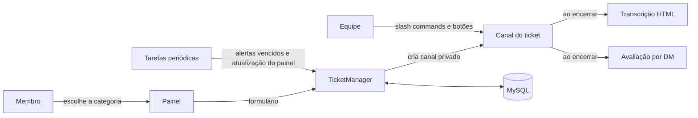

# Discord Ticket System

[](https://github.com/ryanbworks/discord-ticket-system/actions/workflows/ci.yml)
[](LICENSE)


Sistema de atendimento por tickets para servidores do Discord. Os membros abrem um ticket por um painel, respondem a um formulário e recebem um canal privado com a equipe. Ao encerrar, o bot gera a transcrição da conversa e pede uma avaliação do atendimento.

Foi desenvolvido e usado em produção no servidor de roleplay **FOZ RP**, com cinco filas de atendimento (suporte, denúncias, bugs, apelações e financeiro). Tudo o que é específico do servidor fica no `config.yml`, então o mesmo código serve para qualquer comunidade.

## Funcionalidades

- **Painel de abertura** com botões ou menu de seleção, horário de atendimento e atualização automática no início de cada expediente.
- **Categorias configuráveis**: cargos da equipe, cargos notificados, nome do canal, mensagem de abertura e formulário (modal) próprios.
- **Limites e cooldown** por usuário e por categoria, para evitar spam de tickets.
- **Fluxo da equipe**: assumir e liberar o atendimento, adicionar e remover membros, renomear e mover o ticket de categoria.
- **Alerta de inatividade** com `/alertar`: se o usuário não responder no prazo, o ticket é fechado automaticamente.
- **Transcrições em HTML** enviadas para um canal de registro e, opcionalmente, por DM ao usuário.
- **Avaliação de 1 a 5 estrelas** por DM ao encerrar, com comentário e registro do atendente responsável.
- **Horário de atendimento** com vários períodos por dia e fuso horário configurável.
- **Logs de auditoria** de cada ação (abertura, encerramento, atribuição, membros, renomeação, transferência).
- **Estatísticas para administradores** com `/admin-tickets`.

## Como funciona



- `src/lib/tickets/` concentra a regra de negócio: criação, permissões, encerramento e transcrição.
- `src/lib/database.js` cria o esquema na primeira execução e expõe as consultas usadas pelo bot.
- `src/lib/alertChecker.js` e `src/lib/panelRefresher.js` são tarefas periódicas (a cada 30 s e 60 s).
- `src/utils/retry.js` repete chamadas à API do Discord que falham por instabilidade de rede.

## Tecnologias

Node.js 22 · discord.js 14 · MySQL 8 (`mysql2`) · YAML para configuração · discord-html-transcripts · Docker

## Como executar

### Pré-requisitos

- Uma aplicação no [Discord Developer Portal](https://discord.com/developers/applications) com as intents **Server Members** e **Message Content** ativadas.
- Um banco MySQL 8 acessível pelo bot. As tabelas são criadas automaticamente.

### Configuração

```bash
git clone https://github.com/ryanbworks/discord-ticket-system.git
cd discord-ticket-system
cp .env.example .env    # token, IDs do Discord e acesso ao MySQL
```

Depois, ajuste o `config.yml` com os IDs das categorias, cargos e canais do seu servidor. Cada seção do arquivo tem um comentário explicando as opções.

### Com Docker

```bash
docker compose up -d --build
docker compose logs -f
```

O `config.yml` e a pasta `data/` são montados como volumes, então dá para mudar a configuração sem reconstruir a imagem.

### Sem Docker

```bash
npm ci
npm start
```

Os comandos são registrados no servidor automaticamente ao iniciar. Para registrá-los manualmente, use `npm run deploy`.

## Comandos

| Comando | Uso | Quem pode usar |
| --- | --- | --- |
| `/painel` | Envia o painel de abertura de tickets | Administradores |
| `/fechar [motivo]` | Encerra o ticket atual | Equipe |
| `/adicionar <usuário>` / `/remover <usuário>` | Dá ou retira acesso ao ticket | Equipe |
| `/renomear <nome>` | Renomeia o canal do ticket | Equipe |
| `/trocar-categoria` | Move o ticket para outra fila | Equipe |
| `/alertar [tempo] [motivo]` | Avisa o usuário e fecha se não houver resposta | Equipe |
| `/transcricao` | Gera a transcrição sob demanda | Equipe |
| `/admin-tickets info` / `estatisticas` | Detalhes de um ticket e números gerais | Administradores |

## Estrutura

```text
src/
├── commands/slash/   Slash commands
├── events/           Eventos do Discord (interações, mensagens, ready)
├── lib/
│   ├── tickets/      Criação, interações e transcrição de tickets
│   ├── database.js   Esquema e consultas MySQL
│   ├── config.js     Leitura e validação do config.yml
│   └── ...           Tarefas periódicas
└── utils/            Embeds, logs e retry
```

## Licença

[MIT](LICENSE)
